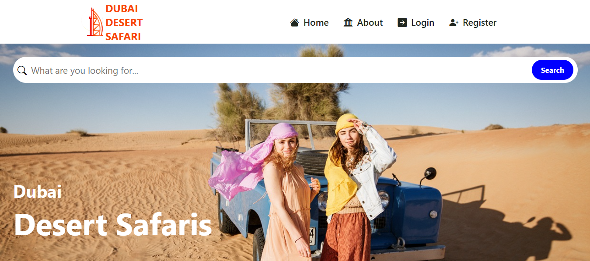
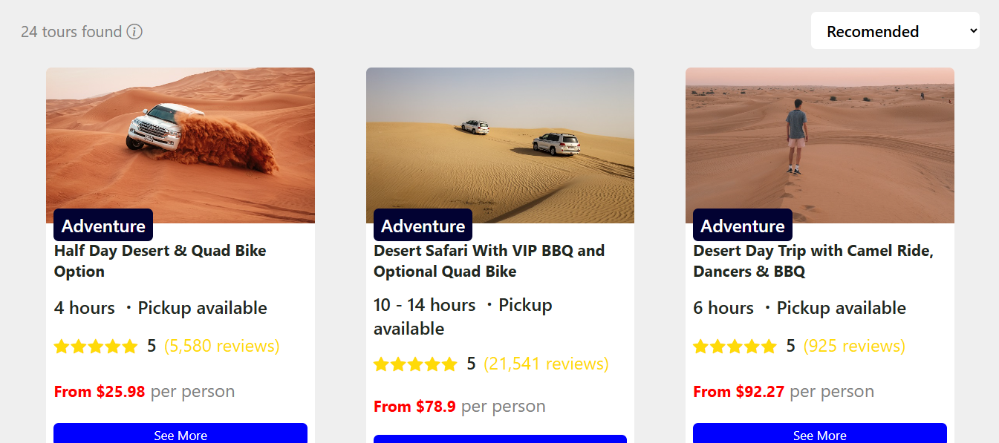
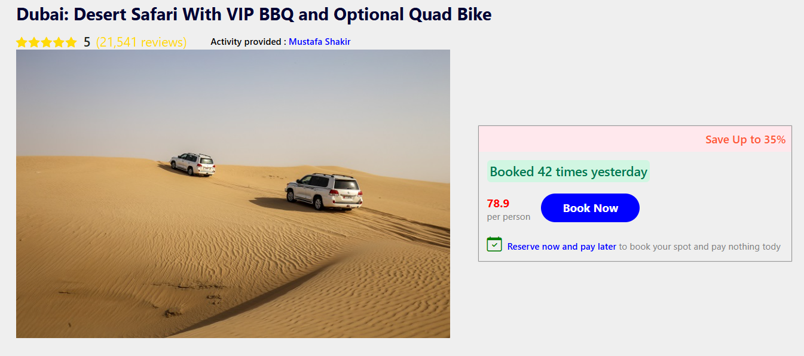
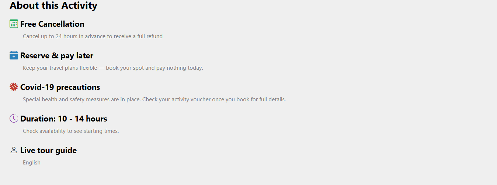
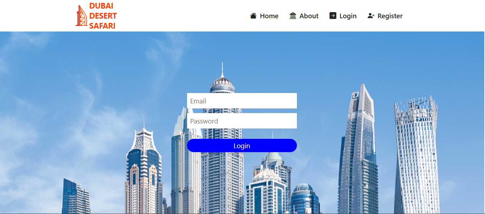
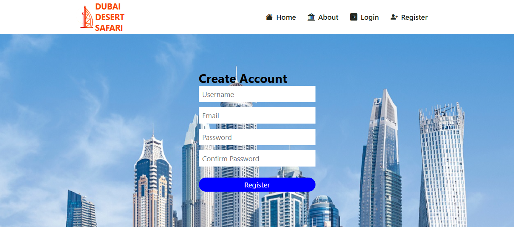

<div align="center">

# 🐪 Dubai Desert Safari

**A responsive tour-booking web app for desert safari experiences in Dubai, built with React 19.**

[](https://mustafacoder365.github.io/Dubai-Desert-Safari/)


<br>



</div>

---

## ✨ Highlights

- 🏜️ **Tour listings** with sorting by price and pagination
- 📄 **Dynamic tour pages** — details, ratings, review counts, and a booking card with pricing
- 🔐 **Login & register** forms with validation and toast notifications
- 🌍 **Language & currency selectors** (UI ready)
- 📰 **Newsletter** signup, services section, and promo banner
- 📱 **Fully responsive** — mobile, tablet, and desktop

## 📄 Pages

| Page | What it does |
|---|---|
| **Home** | Hero, services, tours grid with price sorting and pagination, newsletter |
| **Tour details** | Tour info, rating and reviews, "Book Now" card with starting price |
| **About** | Company story and highlights |
| **Login / Register** | Validated forms with success and error toasts |

## 📸 Screenshots

| Tours | Tour Details |
|---|---|
|  |  |

| Tour Overview | Login |
|---|---|
|  |  |

| Register | |
|---|---|
|  | |

## 🛠️ Tech Stack

| Area | Tools |
|---|---|
| **Framework** | [React 19](https://react.dev/) + [Vite](https://vitejs.dev/) |
| **Routing** | [React Router 7](https://reactrouter.com/) |
| **Notifications** | [React Toastify](https://fkhadra.github.io/react-toastify/) |
| **Icons** | [Bootstrap Icons](https://icons.getbootstrap.com/) |
| **Styling** | Component-scoped CSS3 |
| **Quality** | ESLint |

## 📂 Project Structure

```
src/
├── components/   # Header, hero, services, tours, sorting, pagination, banner, newsletter, footer
├── pages/        # Home, Tour details, About, Login, Register
├── utils/        # Pagination helper
├── data.js       # Tours data
├── App.jsx
└── main.jsx
```

## 🚀 Getting Started

```bash
git clone https://github.com/MustafaCoder365/Dubai-Desert-Safari.git
cd Dubai-Desert-Safari
npm install
npm run dev
```

### Deploy to GitHub Pages

```bash
npm run deploy
```

## 👤 Author

**Mustafa Shakir** — Frontend Software Developer

[](https://github.com/MustafaCoder365)
[](https://www.linkedin.com/in/mustafa-shakir-840374330)
[](mailto:mustafa1997670@gmail.com)

⭐ If you like this project, give it a star!
